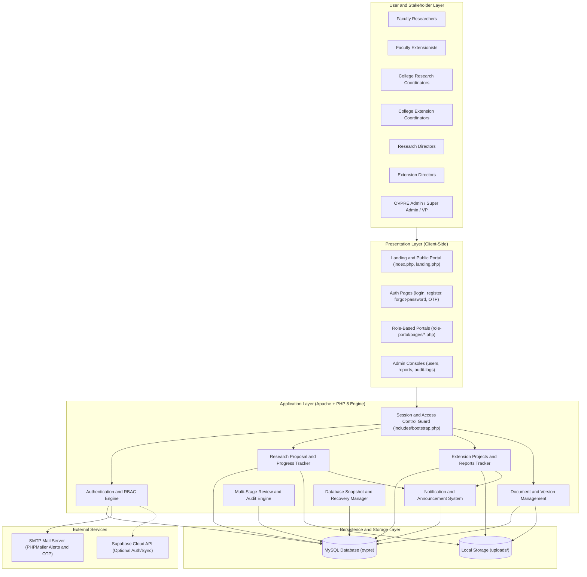
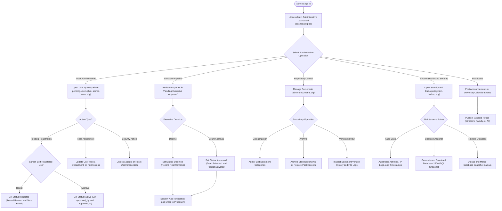
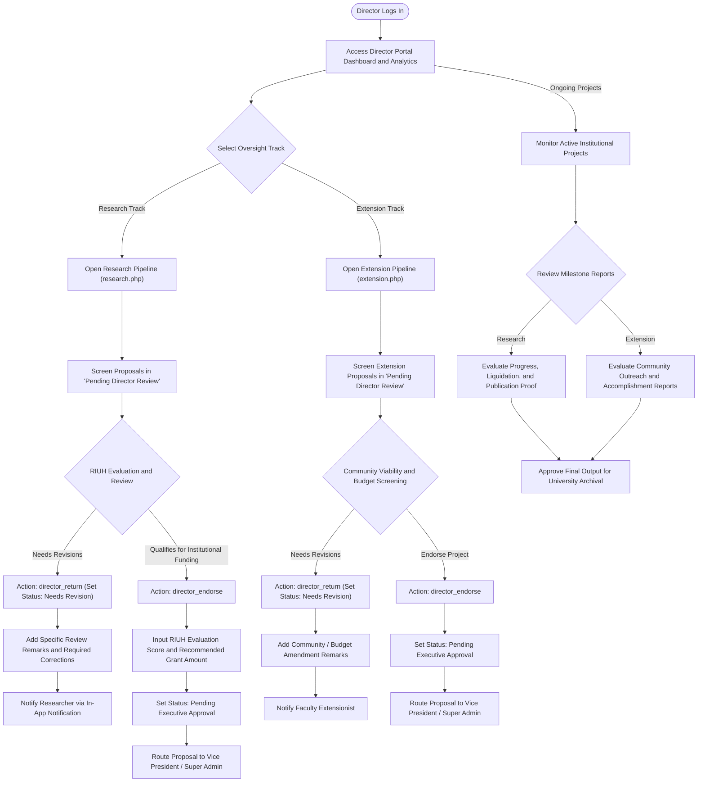
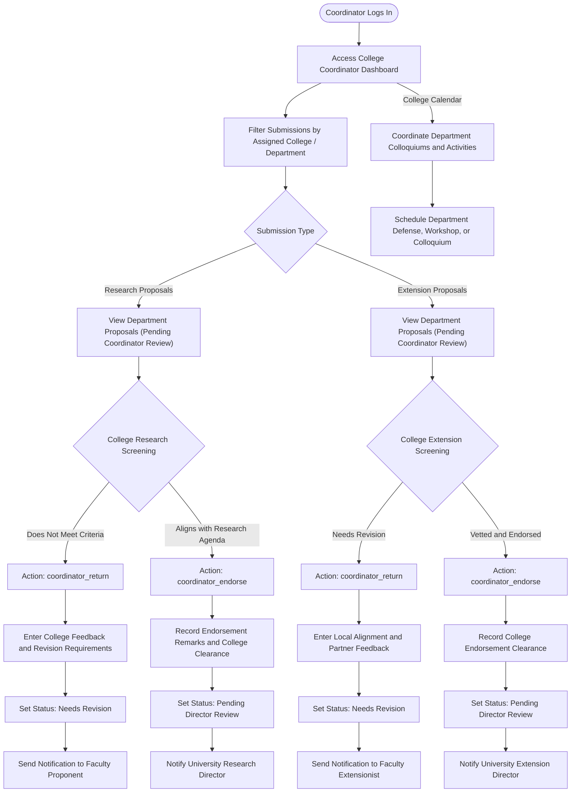
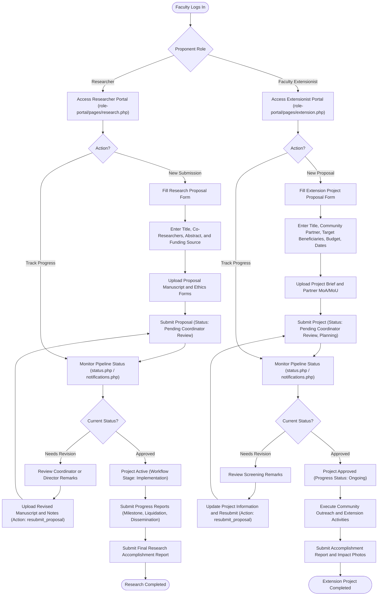
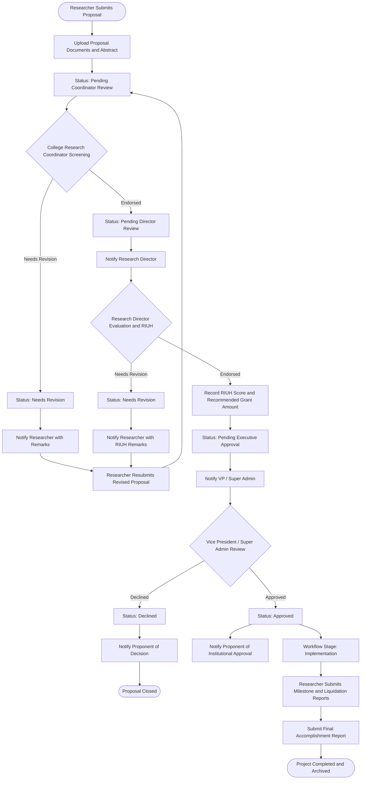
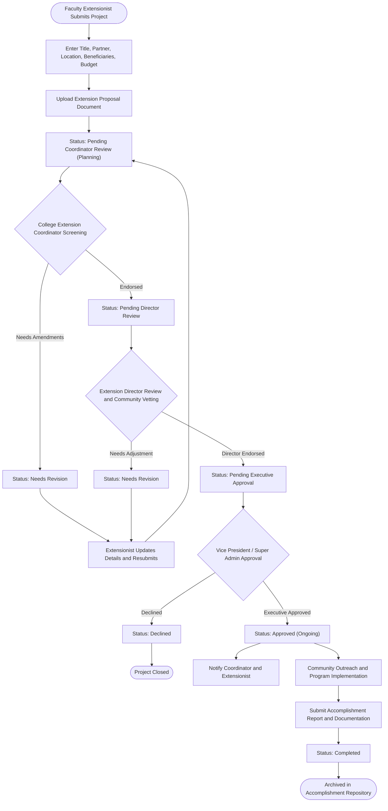
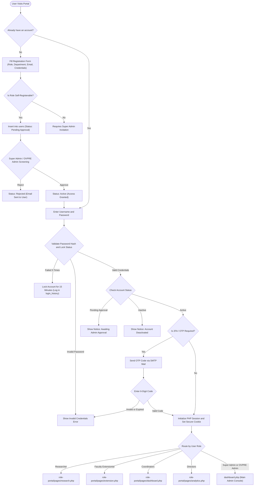
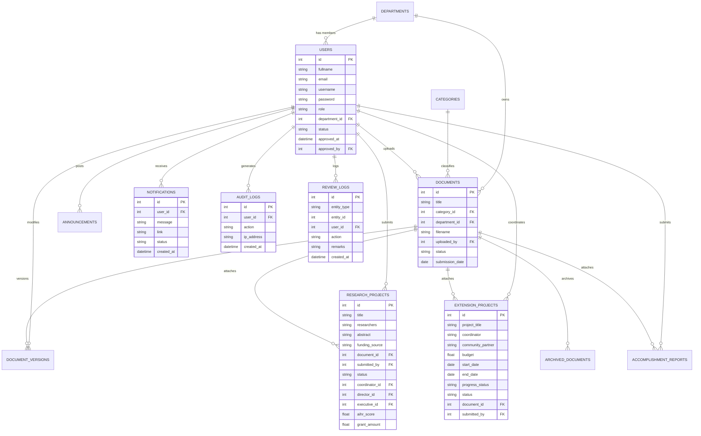

# OVPRE System Diagrams (Mermaid)

> **How to View & Edit in VS Code:**
> 1. Open this file in VS Code.
> 2. Press `Ctrl + Shift + V` (or press `Ctrl + K, V` to open the preview side-by-side).
> 3. All diagrams below are 100% Mermaid syntax-compliant and render automatically in real time.
> 4. You can directly edit any text, labels, or connections in this file to update the diagrams.

---

## 1. System Architecture Block Diagram

---

## 2. System Administrator Flowchart (Super Admin & OVPRE Admin)

This flowchart details the operations, governance, user management, executive approvals, and system maintenance performed by administrators in `dashboard.php`, `admin-users.php`, `admin-pending-users.php`, and `system-backup.php`.

---

## 3. Directors Flowchart (Research Director & Extension Director)

This flowchart details the institutional evaluation, RIUH scoring, grant budget recommendations, and project oversight performed by Directors in `research.php`, `extension.php`, and `analytics.php`.

---

## 4. Coordinators Flowchart (Research Coordinator & Extension Coordinator)

This flowchart details the college-level screening, proposal endorsement, and department monitoring conducted by College Coordinators in `dashboard.php`, `research.php`, and `extension.php`.

---

## 5. Faculty Proponents Flowchart (Faculty Researcher & Faculty Extensionist)

This flowchart details the proposal submission, real-time tracking, revision turnaround, and progress/accomplishment reporting completed by Faculty Proponents.

---

## 6. Research Proposal End-to-End Approval Pipeline

---

## 7. Extension Project End-to-End Approval Pipeline

---

## 8. User Registration, Authentication & RBAC Flowchart

---

## 9. Database Entity-Relationship (ER) Diagram

